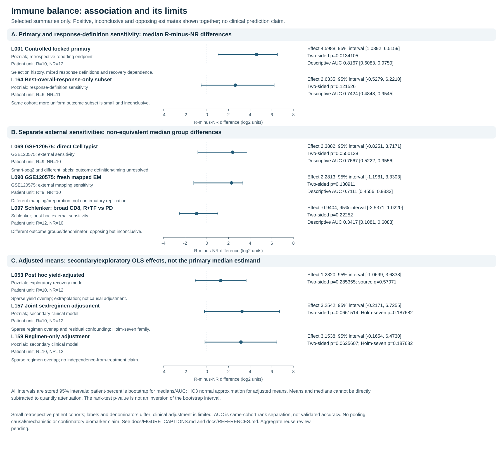

# Immune balance and melanoma immunotherapy response

I asked whether the baseline balance of two annotated immune-cell populations was associated with checkpoint immunotherapy response in a released melanoma cohort. In **22 patients**, the score was higher in responders, but the clinical adjustments and external comparisons did not establish a validated biomarker.

[Case study](docs/CASE_STUDY.md) · [What I did](docs/CONTRIBUTIONS.md) · [Run the synthetic bootstrap](#run-the-synthetic-bootstrap)

## What I did

**Nike Nicole Costa — retrospective computational reanalysis.** I formulated the question, built and ran the workflow using Scanpy, scVI and CellTypist, and defined and analysed the patient-level score. I checked how processing, cell labels and clinical definitions affected the result, then interpreted the positive and inconclusive findings together. The [original investigators](docs/REFERENCES.md) collected the biopsies, generated the sequencing data and supplied the clinical information; I used existing software and reference models.

The runnable examples are teaching code, not the complete study workflow. See the [contribution details](docs/CONTRIBUTIONS.md) for the scope of the original reanalysis and the separate synthetic tutorial.

## Primary result, with its limits

The main unadjusted comparison treats **patients**, not cells, as independent: **22 patients (10 responders, 12 nonresponders)**, from 23 baseline samples and 14,801 retained cells.

For each baseline sample, calculate:

`log2((Tem/Trm cytotoxic T-cell % + 0.5)/(macrophage % + 0.5))`

Then average the **sample scores** within each patient. The pseudocount is 0.5 percentage points; the denominator is the recovered QC-retained immune subset, not whole-tumour tissue. Fixed CellTypist `Immune_All_Low` cluster-majority labels are retained. The T-cell label is not a purified CD8 state.

The responder-minus-nonresponder median difference was **4.60 log₂ units** (95% patient-bootstrap interval **1.04 to 6.52**). Within-cohort AUC was **0.82**, a description of group separation, not validated predictive accuracy.

I fixed the score definition for follow-up checks **after** an earlier association had been observed. The reported test therefore does not account for how the score was originally chosen. The [case study](docs/CASE_STUDY.md) gives the exact estimates and distinguishes the earlier analysis from the later rerun; they did not match exactly.

## Evidence that constrains the conclusion

- Five predeclared same-patient processing sensitivities retained positive direction, but individual scores changed. They are not five independent replications.
- In a secondary model adjusting for sex and treatment regimen, the 95% interval for the adjusted **mean** difference included zero. Sparse treatment overlap limits adjustment; the adjusted mean and unadjusted median answer different questions.
- Recovery adjustment and the best-overall-response-only subset were inconclusive. External comparisons were inconclusive or opposing and non-equivalent to the primary endpoint.
- Annotation definitions differed; compositional selection varied across all four chains with warnings in every chain. Exploratory pseudobulk eligibility was uneven and findings are not mechanistic evidence.



## Explore the research

| Item | Purpose |
| --- | --- |
| [Case study](docs/CASE_STUDY.md) | Selected findings, uncertainty and balanced conclusion |
| [Methods](docs/METHODS.md) and [limitations](docs/LIMITATIONS.md) | Design choices, fixed endpoint and interpretation boundaries |
| [Participant flow](figures/participant_flow.svg) | Released cells → baseline records → patient endpoints |
| [All five processing fits](figures/processing_stability.svg) | Directional stability, intervals and individual-score instability |
| [All nine annotation overlaps](figures/annotation_overlap.svg) | Definition disagreement, not classification accuracy |
| [Figure captions](docs/FIGURE_CAPTIONS.md) | Analysis class, cohort, patient N, effects, uncertainty and limitations |

These are selected summaries, not a complete results register or a count of independent confirmations. Full results and private research evidence remain unchanged outside this package. No patient-level tables, clinical extracts, expression matrices or full aggregate exports are bundled. [Disclosure and source-use limits](docs/DATA_AVAILABILITY.md) still apply to aggregate figures.

## Run the synthetic bootstrap

Use Python 3.11 or 3.12. No package installation, data download or network connection is needed. From the repository folder:

```sh
python3 -I -S -B scripts/run_bootstrap_demo.py
```

Start with [invented cell counts and the analysis code](src/melanoma_portfolio/bootstrap.py). The script converts counts to percentages, calculates a score for each sample, and averages repeat samples within a patient. It resamples **patients with replacement within each response group**, not individual cells or biopsies. The JSON shows the median difference and a 95% percentile bootstrap interval at each of seven pseudocounts, plus the range of estimates after omitting one patient at a time. The omission range is an influence check, **not** a confidence interval.

At the reference pseudocount of 0.5 percentage points, the **invented** cohort's median difference is **1.94 log₂ units** (95% interval **−0.33 to 4.51**). The omission range stays positive (**1.47 to 2.41**), yet the bootstrap interval includes zero. The two checks answer different questions: influence of individual observations versus uncertainty when resampling patients.

The older [arithmetic-only example](scripts/run_synthetic_demo.py) still shows how aggregation and tie-aware AUC work. **Neither example uses study data or recreates the research figures.** They do not run scVI, annotation or clinical models. See [reproducibility](REPRODUCIBILITY.md) for options, tests and what the checks cover.

## Attribution and scope

See [references](docs/REFERENCES.md), [contributions](docs/CONTRIBUTIONS.md), [sources](SOURCES.md), [data availability](docs/DATA_AVAILABILITY.md) and [licensing scope](LICENSING.md). The existing [MIT licence](LICENSE) covers original software only, not all research content or source assets.

The most valuable scientific extension is an independently qualified pretreatment cohort with a documented expression-to-course-aligned patient-overall-response link and an outcome-blind harmonisation plan. This portfolio does not support treatment decisions.
